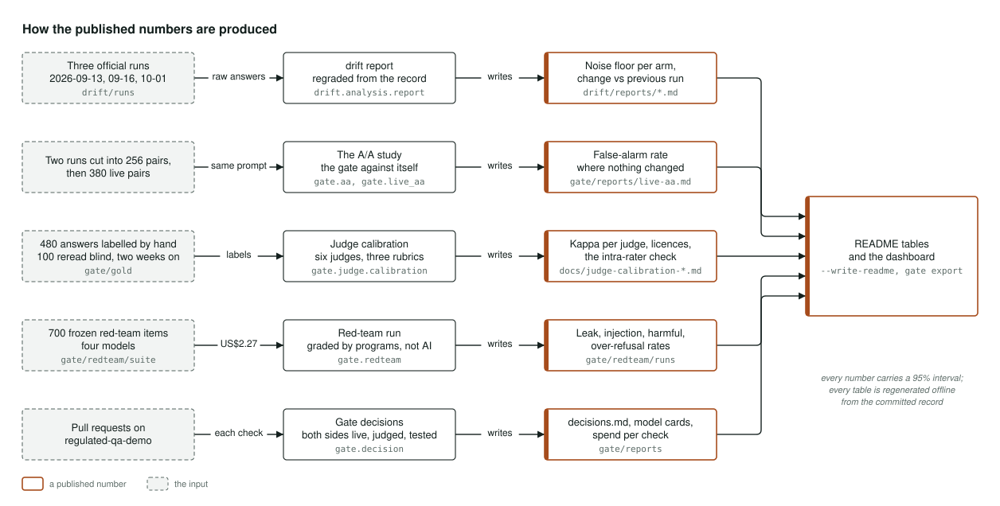

# Architecture

How the project is put together, in four pictures: the two halves of the project and the site
they share, one monthly drift run, one pull request through the gate, and how each published
number is produced. For the reasoning behind the design, read [PLAN.md](../PLAN.md). For the
argument written for someone who has never run an evaluation, read
[your-llm-eval-has-no-error-bars.md](your-llm-eval-has-no-error-bars.md). The same four
pictures are on the live site at
[gate.peterparker.ca/architecture](https://gate.peterparker.ca/architecture).

## The system

The project has two halves, and the diagram puts one on each side.

On the left is the drift record. A frozen test of 420 questions, 20 of them held back and never
published, is put to eight model configurations on the first of every month. A scheduled
workflow runs one job per vendor, and every call goes through the portfolio's gateway with
nothing retried, cached or rewritten, so every call is costed. An ordinary program marks every
answer, and the raw answers go into a record that is only ever added to. The monthly report can
be rebuilt from that record offline, for nothing.

On the right is the gate. 480 answers marked by hand are the standard an AI judge has to meet
before it is trusted, and the person who marked them was checked against their own second
reading. The gate runs as a check on pull requests in a separate demonstration repository: it
answers both sides of the change live, has the judge grade them, and decides. Every decision is
written to a ledger and to the model cards. Alongside, four red-team suites put 700 frozen
attack and control questions to four models.

In the middle is what both halves share: the power calculation borrowed from project 02, and
the export that writes every page and data file of gate.peterparker.ca each night, then reads
the live site back to confirm it is serving what was just built.

Where it lives: `drift/suite`, `drift.graders`, `drift/runs`, `drift.analysis`, `gate/gold`,
`gate.judge`, `gate.live`, `gate.decision`, `gate.ledger`, `gate.redteam` and `service`.

## One monthly drift run

The run is scheduled for 06:00 UTC on the first of the month, though GitHub often starts it
hours late.

A planning job reads the list of models and the dated price list, and sets a spending cap from
the expected cost. The work then fans out to one job per vendor: Anthropic with three
configurations, OpenAI and Google with two each, and an open-weights model on Together as the
control. Each job asks its models one after another, pausing to respect the vendor's rate
limit, and every call goes through the gateway. Each configuration answers all 420 questions
five times. The answers to the held-back questions are replaced by a fingerprint before anything
is committed, so they never become public.

A program marks every answer. The refusal block, 20 questions asked five times, is read by hand,
without knowing which model gave which answer.

A final job gathers everything into the month's record and compares it with the previous month.
It writes the report with the same-day noise floor, the change since last month, the refusals
and the cost per thousand calls, updates the README's table, and commits. The site is rebuilt
the next morning and the call costs are pushed to the portfolio's central ledger.

Where it lives: `.github/workflows/drift.yml`, `drift.runner`, `drift.graders` and
`drift/reports`.

## One pull request through the gate

Someone opens a pull request that changes a prompt or a model.

The gate answers the test questions twice, once with the old version and once with the new,
live, with nothing cached, through the gateway and under a spending cap for each check. An AI
judge, Gemini 3.8 Flash, grades every answer. It earned that job by agreeing with the 480 hand
marks at a kappa of 0.924, and it kept its licence against the marker's blind second reading at
0.851. The judge's own known error rate is taken out of the difference, so a judge's mistakes
cannot pass as a real change.

The two sides are then compared question by question. The test asks whether the new version is
no more than ten points worse, with a bootstrap interval, after a check that there are enough
questions to tell. That check uses project 02's calculation of how many questions a decision
needs. The gate's false-alarm rate comes from running it against itself where nothing changed.

The verdict, pass or blocked, is posted back on the pull request with its evidence. Each side's
interval, cost and response time go to the ledger, the decisions log and the model cards.
Another project can hand the gate its own marked results through an adapter and get the same
decision and the same record.

Where it lives: `action/action.yml`, `gate.live`, `gate.judge`, `gate.stats`,
`gate.power_check`, `gate.aa`, `gate.ledger` and `gate.cards`.

## How the published numbers are produced

Every number in the README comes from a committed input, through one command, into a stored
report. This is where each one comes from.

The drift table comes from the official runs in the record, re-marked into the noise floor for
each model and the change since the previous run. The gate's false-alarm rate comes from
comparisons where nothing changed: 256 pairs cut from two September runs, then 380 pairs on the
live test. The judges' licences come from checking six judges under three marking schemes
against the 480 hand marks, a hundred of which were re-read blind two weeks later. The red-team
rates come from 700 frozen questions on four models, marked by programs with refusals read by
hand. The decisions table comes from the gate's own ledger over the pull requests it has
checked.

Every number carries a 95% interval. Every table is written into the README by its own command,
and the site is exported from the same committed files by the same code, so a reader can
rebuild any of it offline.

Where it lives: `drift.analysis.report`, `gate/reports`, `gate/redteam/runs` and the judge
calibration reports in `docs/`.
